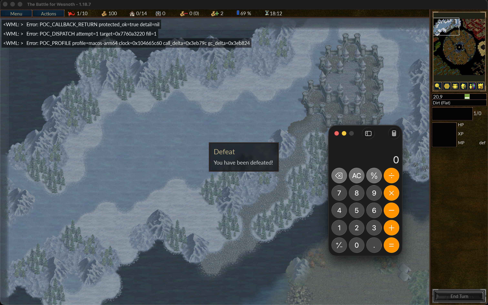

# Wesnoth 1.18 - Type Confusion RCE

This repository houses the full exploit code for the accompanying blog writeup.

* [Part 1](https://0day.gg/blog/pwning-wesnoth/)
* [Part 2](https://0day.gg/blog/pwning-wesnoth-part-2/)

The provided exploit is a multiplayer scenario with selectable targets. To support additional platform or build versions, you'll have to update the relevant offsets.

`TARGET_PLATFORM` must be selected. It's possible to detect the target build and platform through some heuristics, but I've intentionally left these unimplemented.

